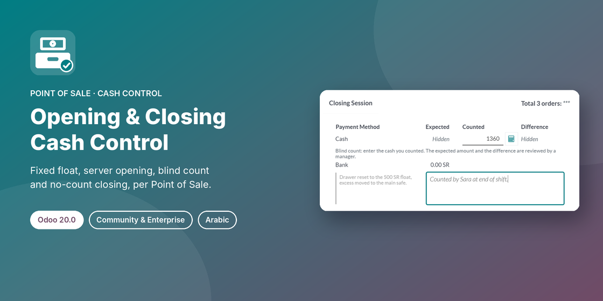

# POS Cash Management Control

Per-Point-of-Sale **opening and closing cash control** for Odoo: fixed float, opening on the server, blind count and no-count closing, with every rule enforced server-side and accurate cash register and accounting entries. English and Arabic.



## Supported versions

One branch per Odoo version (this branch: **20.0**).

| Branch | Odoo |
|---|---|
| [`16.0`](https://github.com/ibrahim77818/pos_cash_management_control/tree/16.0) | Odoo 16.0 Community & Enterprise |
| [`17.0`](https://github.com/ibrahim77818/pos_cash_management_control/tree/17.0) | Odoo 17.0 Community & Enterprise |
| [`18.0`](https://github.com/ibrahim77818/pos_cash_management_control/tree/18.0) | Odoo 18.0 Community & Enterprise |
| [`19.0`](https://github.com/ibrahim77818/pos_cash_management_control/tree/19.0) | Odoo 19.0 Community & Enterprise |
| [`20.0`](https://github.com/ibrahim77818/pos_cash_management_control/tree/20.0) | Odoo 20.0 Community & Enterprise |

## Features

**Opening Cash Control** (per Point of Sale)
- **Standard Count**: unchanged Odoo behaviour (default).
- **Count with Suggested Fixed Float**: the float is pre-filled; the gap with the last closing balance is booked as a float transfer, not as a cash difference.
- **Open on Server with Last Closing Balance**: no count; the very first session falls back to a standard count.
- **Open on Server with Fixed Float**: no count; the drawer is reset to the float and the gap is booked as a float transfer.
- Optional **Float Transfer Account** (e.g. the main safe); the suspense account is used otherwise.

**Closing Cash Control** (per Point of Sale)
- **Standard Count**: unchanged Odoo behaviour (default).
- **Blind Count**: cashiers enter the counted cash without seeing the expected amount, the difference or the session total; POS managers keep full visibility. A count is mandatory and cannot be negative.
- **No Count**: the server records the expected cash as counted; no difference is posted.
- **Hide Daily Sale from Cashiers**: hidden in the POS and refused by the server for non-managers.

**Safety**
- Settings are cached once at POS load (no extra RPC) and locked while a session is in progress.
- Server-side enforcement in `pos.session`: no client call can choose a server-opened balance or bypass blind / no-count rules.

Odoo 20 gives each session its own cash statement: the float transfer is a line of that statement, counting differences are booked as cash corrections, and Expected Closing Cash, Counted Closing Cash and Closing Cash Difference are stored on the session (expected and difference for POS managers only). In Blind Count the pre-filled cash count starts at zero.

## Installation

1. Clone branch `20.0` and add the repository folder to your addons path (the module is the `pos_cash_management_control` folder).
2. Update the apps list and install **POS Cash Management Control**, or run:
   ```bash
   odoo-bin -d <database> -i pos_cash_management_control
   ```
3. Depends on: `point_of_sale`, `pos_hr`.

## Configuration

**Point of Sale › Configuration › Settings** › select the Point of Sale › **Cash Management Control** (visible when the POS has cash control / a cash payment method).

## Tests

```bash
odoo-bin -d <database> --test-tags /pos_cash_management_control --stop-after-init
```

## Author & license

**Ibrahim Yahia** · [LinkedIn](https://www.linkedin.com/in/ibrahim-yahia) · ibrahim.yahiah@gmail.com
License: LGPL-3

